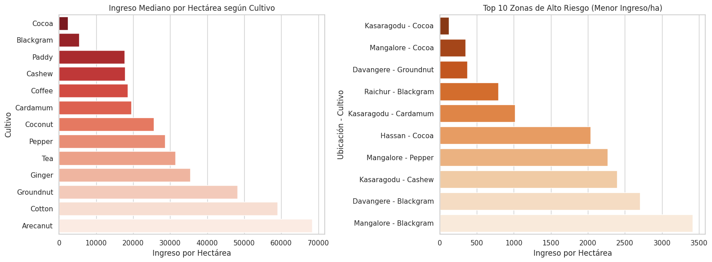
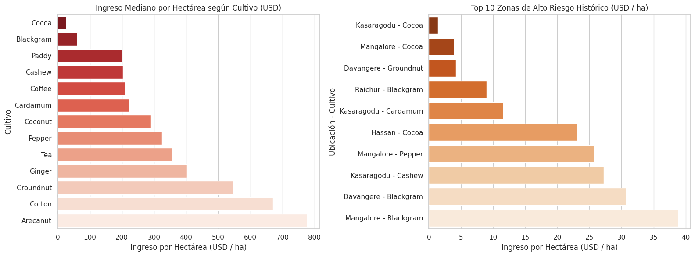
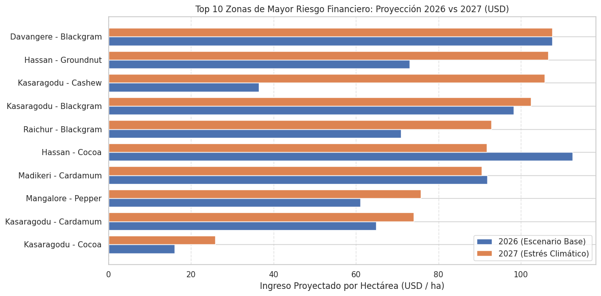

# Karnataka Agriculture Yield Prediction, Financial Risk & Climate Stress Simulation

End-to-end machine learning and agricultural economics pipeline analyzing 16 years of crop, weather, soil, and pricing data across Karnataka, India (2004–2019). The project combines supervised imputation, temporal validation, log-transformed ensemble regression, 2026–2027 climate stress simulation, and an operational **Unit Management Index (UMI)** parcel-segmentation strategy to mitigate projected revenue losses.

---

## Business Problem & Objectives

Agricultural revenue per hectare varies dramatically across crops, soil types, irrigation methods, and microclimates. Smallholder and regional planners need data-driven answers to three operational questions:

1. **Data Completeness:** Can missing soil classifications be reliably imputed from environmental, spatial, and crop features?
2. **Yield & Revenue Forecasting:** How accurately can physical yield (`Tn/ha`) be predicted without target/price leakage under a strict temporal split?
3. **Climate Risk & Mitigation:** Which location–crop pairs face the highest financial risk under a 2027 climate stress scenario (-15% rainfall, +1.5°C temperature, +6% price), and how much revenue can be recovered by segmenting oversized parcels into optimal sub-plots (UMI)?

---

## Dataset

- **Source:** [`imtkaggleteam/agriculture-dataset-karnataka`](https://www.kaggle.com/datasets/imtkaggleteam/agriculture-dataset-karnataka) (via `kagglehub`)
- **Raw Records:** 3,158 observations (`data_season.csv`)
- **Time Span:** 2004–2019 (16 years)
- **Coverage:** 11 locations (`Bangalore`, `Chikmangaluru`, `Davangere`, `Gulbarga`, `Hassan`, `Kasaragodu`, `Kodagu`, `Madikeri`, `Mangalore`, `Mysuru`, `Raichur`) and 13 crops
- **Features:** `Year`, `Location`, `Area(ha)`, `Rainfall(mm)`, `Temperature(C°)`, `Soil type`, `Irrigation`, `Humidity(%)`, `Crops`, `Season`, `price`, `Produccion_Total(Tn)`, and `yield_per_area(Tn/ha)`

---

## Methodology

1. **Supervised Missing-Value Imputation (`Soil type`):**
   - Split the dataset into non-null (`3,100` rows) and null `Soil type` subsets.
   - Trained a `RandomForestClassifier` on one-hot encoded features (`pd.get_dummies(..., drop_first=True)`), achieving **89.52% validation accuracy** (`0.89516`) to impute missing soil types.
2. **Outlier & Anomaly Cleaning:**
   - Replaced physically impossible temperatures (`> 50°C`) with location-level medians (and remaining nulls with the global median).
   - Filtered extreme yield-per-hectare artifacts (e.g., `Area = 1 ha` anomalies above the 90th percentile of `244.21 Tn/ha`), retaining **2,842 clean records** (from 3,158 raw rows).
3. **Leakage-Free Temporal Validation:**
   - Excluded `Year`, `price`, `Produccion_Total(Tn)`, `Income_Total`, and `Income_per_ha` from predictors `X` so models learn purely from agronomic, spatial, and climate signals.
   - Evaluated on a strict temporal split: **2004–2017 (train)** vs. **2018 (test)**.
   - Benchmarked `RandomForestRegressor` on raw yield vs. log-transformed target (`np.log1p(y)` + `np.expm1` inversion) vs. `ExtraTreesRegressor`.
4. **2026–2027 Climate Stress Simulation & UMI Strategy:**
   - Retrained the winning `RandomForestRegressor` (`log1p` target) on the full 2004–2019 clean dataset (`2,842` records) across **98 Location–Crop combinations**.
   - Simulated **2026 Baseline** (`0%` rainfall change, `+0.0°C`, `+3%` price) vs. **2027 Climate Stress** (`-15%` rainfall, `+1.5°C` temperature, `+6%` price), converted to USD at `1 USD = 88.0 INR`.
   - Derived optimal parcel area (`Area_Optima_ha`) per `(Crops, Soil type)` from the median area of the top 20% highest-earning historical records, and modeled realistic operational gains via diminishing-returns elasticity (`ELASTICIDAD_UMI = 0.35`).

---

## Key Results & Metrics

### Model Comparison (2018 Temporal Holdout)

| Model | Target Transform | Yield MAE (Tn/ha) | Yield $R^2$ (Real Scale) | Yield $R^2$ (Log Scale) | Revenue MAE (INR/ha) |
| :--- | :--- | :---: | :---: | :---: | :---: |
| `RandomForestRegressor` (V2) | Raw (`y`) | 15.28 | 0.23 | — | 1,804,437.33 |
| **`RandomForestRegressor` (V3 — Winner)** | **`log1p(y)`** | **11.65** | **0.25** | **0.59** | **1,470,822.29** |
| `ExtraTreesRegressor` | `log1p(y)` | 12.07 | 0.23 | 0.59 | — |

### Top Feature Importances (Winning Model)

| Feature | Importance |
| :--- | :---: |
| `Area(ha)` | 50.07% |
| `Rainfall(mm)` | 6.79% |
| `Humidity(%)` | 5.81% |
| `Temperature(C°)` | 4.74% |
| `Crops_Coconut` | 4.55% |

### 2027 Climate Stress & UMI Segmentation Impact (Selected High-Risk Zones, USD/ha)

| Location | Crop | Current Area (ha) | Optimal Area (ha) | UMI Sub-Plots | 2027 Actual (USD/ha) | 2027 Realistic UMI (USD/ha) |
| :--- | :--- | :---: | :---: | :---: | :---: | :---: |
| Kasaragodu | Cocoa | 17,549.5 | 153.0 | 115 | \$25.84 | \$68.72 |
| Kasaragodu | Cardamum | 3,467.0 | 103.0 | 34 | \$74.07 | \$165.22 |
| Mangalore | Pepper | 15,009.0 | 2,578.0 | 6 | \$75.81 | \$122.55 |
| Madikeri | Cardamum | 13,283.0 | 596.5 | 23 | \$90.47 | \$188.73 |
| Hassan | Cocoa | 10,922.0 | 161.5 | 68 | \$91.81 | \$227.22 |

---

## Visualizations

### Historical Financial Risk by Crop & Location (INR)


### Historical Financial Risk by Crop & Location (USD)


### 2026 Baseline vs. 2027 Climate Stress Projection (USD/ha)


---

## Repository Structure

```text
karnataka-agriculture-ml/
├── assets/
│   ├── climate_stress_projection_2026_2027_usd.png
│   ├── historical_financial_risk_inr.png
│   └── historical_financial_risk_usd.png
├── notebooks/
│   └── karnataka_agriculture_yield_ml.ipynb
├── .gitignore
├── README.md
└── requirements.txt
```

---

## Installation & Execution

```bash
# 1. Clone the repository
git clone https://github.com/KurosawaKai/karnataka-agriculture-ml.git
cd karnataka-agriculture-ml

# 2. Create and activate a virtual environment
python -m venv .venv
source .venv/bin/activate  # On Windows: .venv\Scripts\activate

# 3. Install dependencies
pip install -r requirements.txt

# 4. Launch Jupyter and run the notebook
jupyter notebook notebooks/karnataka_agriculture_yield_ml.ipynb
```

> **Note:** Running the notebook downloads the dataset automatically via `kagglehub`. Ensure Kaggle credentials are configured if required by your environment.

---

## Author

**Miguel Ángel Tamer Meyer** (`KurosawaKai`)  
- LinkedIn: [https://www.linkedin.com/in/ma-tm](https://www.linkedin.com/in/ma-tm)
